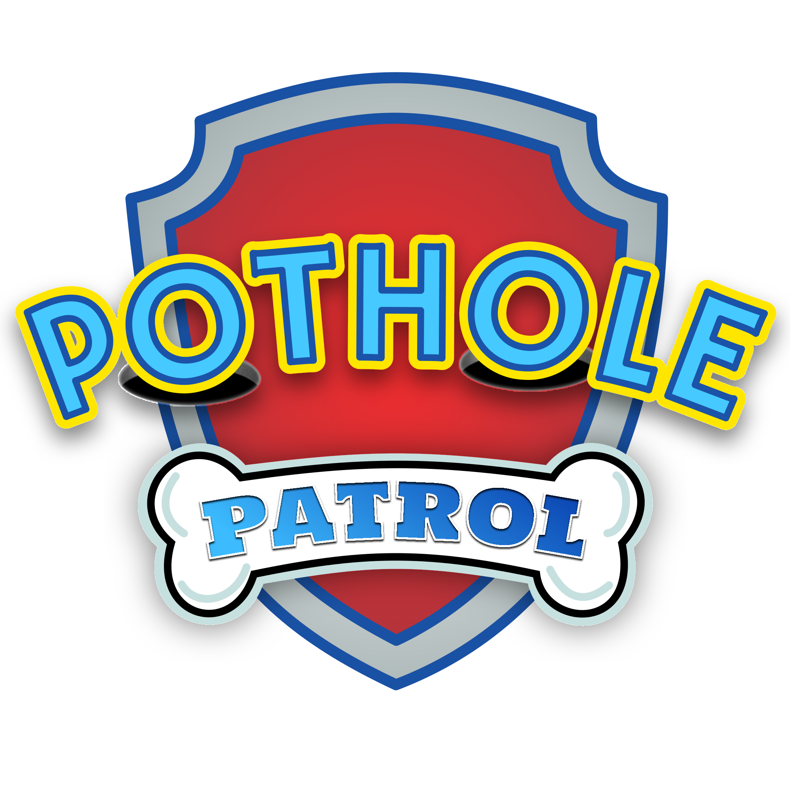

# Pothole Patrol - NYCAIRR Hackathon Submission

Created by Kenneth Ng, Tiffany Lin, and Ryan Zhou for the NYCAIRR Hackathon.

## Program Purpose

Pothole Patrol uses cameras that are already on the road to detect potholes in
real-time and share the data with cities and governments to help them prioritize
road repairs. After seeing the viral posts about Mayor Mamdani fixing potholes
in New York City, we wanted to create a solution to help cities like New York
City detect (and hopefully fix) more potholes than ever.

## Program Functionality

Users connect with the camera frontend to continuously poll and stream video
from their cameras to the WebSocket server. This camera serves as a stand-in for
a dashcam or any other type of camera that travels on the road.

The WebSocket server recieves the video stream and forwards it, along with extra
metadata used later in the process for calculations, to the model backend via
gRPC.

The model backend uses a YOLOv8 model to detect potholes in the video stream.
Then, if a pothole is detected, several other information points are fetched and
calculated, including, but not limited to:

- Average income areas
- Population of the area
- Commercial impact of the pothole
- Severity of the pothole

Then, the model backend sends the data to the API backend via a persistent
unidirectional gRPC stream. The API server stores the data in a PostgreSQL
database and serves it to the dashboard frontend via a standard REST API.

Other users can now connect to the dashboard frontend to view pothole data in
real-time, including a map of potholes and a recommended repair priority list
based on the data collected and our algorithms.

## Our Tech Stack

We used a microservice architecture philosophy to build our application, with
each component being able to be scaled independently for different workloads.
The following technologies were used to build our application:

- Nuxt.js (Vue) for the camera frontend
- Express.js + Socket.IO for the WebSocket server
- YOLOv8 + PyTorch for the model backend
- Rocket.rs + PostgreSQL for the API backend
- Next.js (React) for the dashboard frontend app

- gRPC for inter-server communication
- WebSockets for communication between camera and WebSocket server
- REST API for communication between dashboard frontend and API backend

## Known Limitations

The current limitation is bottlenecked by how fast the CV model can process
images, so about 1-2 FPS per model backend instance. This could be improved with
a more optimized model or by using multiple model backend instances to process
images in parallel.

Also, API calls to the US Cencus Bureau and Geocodio are rate-limited, so we
have to cache results to avoid hitting the rate limit. This is a known
limitation that we would like to improve in the future.

## AI Usage

AI was used to debug parts of our code.
